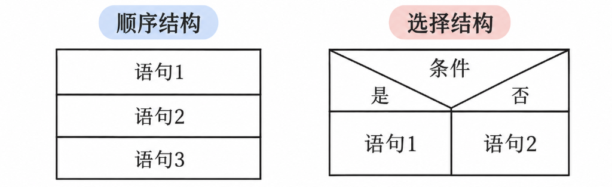
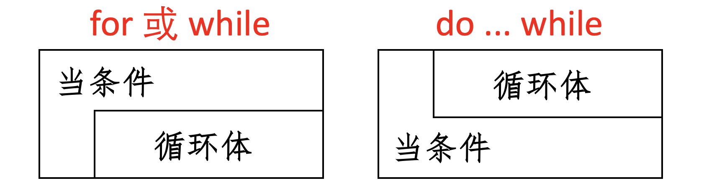

# 初步认识结构化算法

1966 年，Bohm 和 Jacopini 证明了***任何单入单出、没有死循环的程序都可以用三种控制结构构造出来***，无需借助 **goto** 语句

这三种控制结构就是**基本控制结构**：**顺序、选择和循环**

结构化程序设计是编写清晰、正确且易于修改的程序的严格方法。其实质是**分而治之**的分治思想，将一个比较复杂的系统设计问题分解为一个个容易处理的子问题，再逐一加以解决

三大标准：***自顶而下、逐步求精、模块化***

---

### 3.3 N-S 图描述算法

ANSI 公司定义了传统的流程图，而 IBM 公司的两位科研人员提出了一种改进方案：**取消流线，一律从上到下**，这就是**N-S 流程图**，俗称*盒图*

---

### 3.4 顺序结构算法举例

程序设计中，应尽量**减少运算的次数**并**选择速度快的运算**

###### 运算速度由快到慢排序

$$
位>逻辑>加减>乘除>取模>函数
$$

因此多项式计算时常被**分解**，对于 $p_n(x)=p_nx^n+p_{n-1}x^{n-1}+...+p_1x+p_0$

$$
p_n(x)=((...(p_n\cdot x+p_{n-1})\cdot x+p_{n-2})\cdot x+...)\cdot x+p_0
$$

> ###### 举例
>
> 如函数 $f(x)=3x^3-5x^2+x-10$ 可写为
>
> $$
> f(x)=((3\cdot x-5)\cdot x+1)\cdot x-10
> $$

---

#### 3.5.2 编译预处理命令的使用

`#include` 的功能是用**被包含文件**中的**所有内容替换**该预处理语句

---

### 3.6 C 编程规范

**宏定义**

- 必须全部以**大写字母**书写，复合词可根据意义的连续性用下划线链接

- ***每一条定义右侧必须有一简单注释***

---

### 3.8 顺序结构算法实验

***每一步都获得当前解题的最优方案***，这种算法被称为 “贪婪算法”，即**贪心算法**

贪心算法的最大特点是**有直觉倾向**

***—— 2025.3.15***
