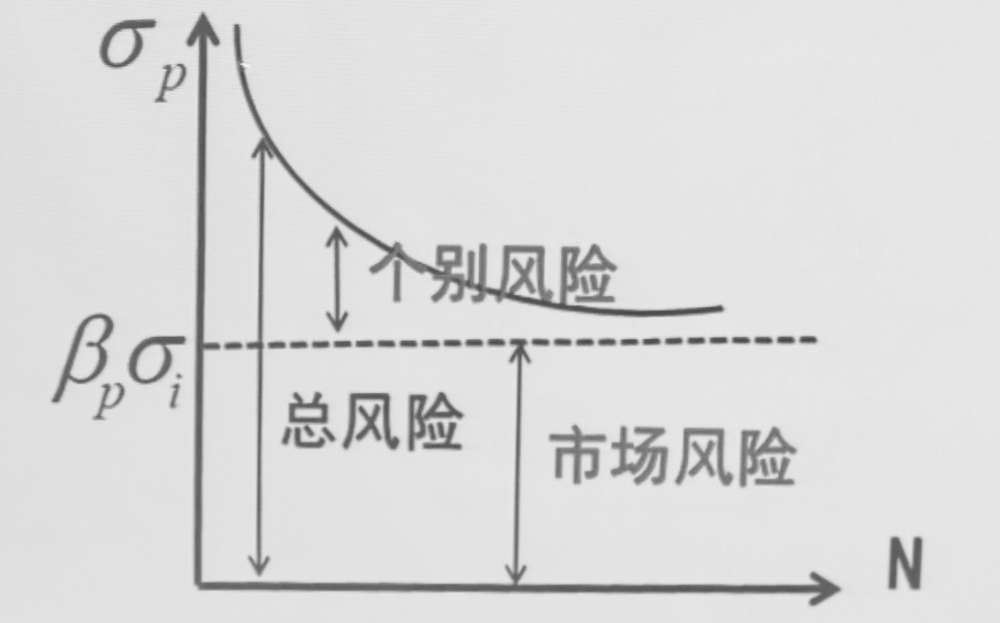

# 收益和风险

---

### 第一节 收益和风险

#### 一、收益与预期收益

- 投资带来的回报被称为**收益**

- 我们往往无法确定实际回报的大小，但可以预期正常情况下这项投资的平均回报，这个回报就是**预期收益**

##### （一）收益与收益率

- **收益**：投资期末的收入减去投资期初的投入

- **收益率**：收益相对于期初投资的百分数（*按单位计算即可*）

> *收益率比收益更能代表单位投资的回报*

##### （二）预期收益率

*未来收益往往无法确定，预期收益率可以近似描述投资收益率的均值*

| 宏观经济状况 | 概率（%） | A 公司收益率 $R_{At}$ | B 公司收益率 $R_{Bt}$ |
| ------------ | --------- | --------------------- | --------------------- |
| 萧条         | 20        | -20                   | 5                     |
| 衰退         | 30        | 10                    | 20                    |
| 正常         | 30        | 20                    | -10                   |
| 繁荣         | 20        | 40                    | 10                    |

分别计算加权平均

$$
\bar{R_A}=\sum R_{At}\cdot P_t=(-20\%)\times20\%+...+40\%\times20\%=13\%
$$

$$
\bar{R_B}=\sum R_{Bt}\cdot P_t=5\%\times20\%+...10\%\times20\%=6\%
$$

因此判断比较两个公司的预期收益率

#### 二、风险与方差

一般来讲，预期收益变动范围越大，风险就越大；这就要求定量描述风险的指标一定要能够反映**资产收益（将来价格）的变动范围**

实际应用中，*方差*和*标准差*常被用来作为资产风险的度量标准，其中*标准差*又称*波动率*

| 宏观经济状况 | 概率 | 收益率   | 收益率的离差       | 离差平方               | 加权平均和 = 0.0381            |
| ------------ | ---- | -------- | ------------------ | ---------------------- | ------------------------------ |
| $A 公司$     | $P$  | $R_{At}$ | $R_{At}-\bar{R_A}$ | $(R_{At}-\bar{R_A})^2$ | $(R_{At}-\bar{R_A})^2\times P$ |
| 萧条         | 0.2  | -0.2     | -0.33              | 0.1089                 | 0.02178                        |
| 衰退         | 0.3  | 0.1      | -0.03              | 0.0009                 | 0.00027                        |
| 正常         | 0.3  | 0.2      | 0.07               | 0.0049                 | 0.00147                        |
| 繁荣         | 0.2  | 0.4      | 0.27               | 0.0729                 | 0.01458                        |

> B 公司计算方法一致，最终得到 **0.0139**

标准差 $\sigma=\sqrt{\sigma^2}$，因此 

- $\sigma_A=\sqrt{0.0381}=19.57\%$

- $\sigma_B=\sqrt{0.0139}=11.79\%$

#### 三、资产组合的收益与风险

##### （一）单个证券占资产组合的权重

$X=单个证券价值/资产组合的总价值$，即**价值的权重**

> ***资产组合内所有证券的权重之和等于 1***

##### （二）协方差和相关系数

反映资产与资产之间二者关系的工具，就是*协方差*和*相关系数*

###### 1. 协方差

$$
\sigma_{AB}=cov(R_A,R_B)=E[(R_A-\bar{R_A})(R_B-\bar{R_B})]=\\\sum(R_A-\bar{R_A})(R_B-\bar{R_B})\times两个离差同时发生的概率
$$

只能反映两个资产收益之间的*变动方向*，为正相同，反之不同，***为零则不相关***

###### 2. 相关系数

$$
\rho_{AB}=\frac{cov(R_A,R_B)}{\sigma_A\times\sigma_B}=\frac{\sigma_{AB}}{\sigma_A\times\sigma_B}
$$

- 符号说明相关方向

- 绝对值越趋近 $1$，相关程度越大

- 绝对值越趋近 $0$，相关程度越小

##### （三）资产组合的收益与风险

构成组合的**各个证券的预期收益**按**单个资产占组合权重**进行**加权平均**

$$
\bar{R_P}=\sum_{i=1}^nX_i\bar{R_i}
$$

> ###### 举例
>
> 包含两个证券 $1$ 和 $2$ 的资产组合
>
> **方差**
>
> $$
> \sigma_P=X_1^2\sigma_1^2+2X_1X_2\sigma_{12}+X_2^2\sigma_2^2
> $$
>
> **标准差**
>
> $$
> \sigma_P=[X_1^2\sigma_1^2+2X_1X_2\sigma_{12}+X_2^2\sigma_2^2]^{\frac{1}{2}}
> $$

---

### 第二节 市场风险

#### 一、市场指数模型

##### （一）模型

任意证券在某一给定时期内的收益率与同一时期的市场指数的收益率相联

- 如果市场行情上扬，该证券价格很可能上升（或下降）

- 如果市场行情下滑，该证券价格很可能下降（或上升）

即**呈线性关系**

则一定时期内证券的收益率与同期市场收益率的关系可以用市场指数模型描述

$$
R_i=\alpha_{iI}+\beta_{iI}R_I+\epsilon_{iI}
$$

- $R_i$：股票收益率

- $R_I$：市场收益率

- $\epsilon_{iI}$：随机误差项

> 因此该模型其实就是 $y=kx+b$ 的形式
>
> 随机误差项也完全遵从计量经济学的一切要求，如正态分布等

预期值则为标准一元线性关系

$$
E(R_i)=\alpha_{iI}+\beta_{iI}E(R_I)
$$

利用该模型，即可通过市场指数的预期收益率计算股票的预期收益率

##### （二）分析

斜率可以看作是一个证券收益率相对于市场指数收益率变化的**敏感性**

这个斜率通常被称为不同证券市场指数收益率变化的**贝塔值** $\beta$，其值越大，表明对市场指数收益率变化越敏感

$$
\beta=\frac{\sigma_{iI}}{{\sigma_I}^2}
$$

- 大于 1：收益率变动相对于市场指数变动敏感，即其变动程度大于市场指数的变化程度，被称为**进攻型证券**

- 小于 1：收益率变动相对于市场指数变动不敏感，即其变动程度小于市场指数的变化程度，被称为**防御型证券**

#### 二、系统风险和非系统风险

根据市场指数模型，任何证券 $i$ 的方差可以被表示为

$$
{\sigma_i}^2={\beta_{iI}}^2{\sigma_I}^2+{\sigma_{\epsilon i}}^2
$$

- ${\sigma_{\epsilon i}}^2$：与证券所对应公司（资产）的不确定性，即**非系统风险对证券风险的贡献**

- ${\beta_{iI}}^2{\sigma_I}^2$：市场指数风险与证券贝塔值的乘积，即**系统风险对证券风险的贡献**

系统风险会对大多数资产产生影响，由于不同资产贝塔系数不同，其受影响程度不同

非系统性风险是指对某一种或某一类资产产生影响的风险，一般为某一公司所特有，故又称*特有风险*，不会对市场产生影响

#### 三、分散化与组合风险

对于资产组合 $P$，假设投资于每一个证券 $i$ 的权重为 $X_i$，则组合的收益率为

$$
R_P=\sum_{i=1}^n X_iR_i
$$

将**市场指数模型**的公式代入，则组合的市场指数模型

$$
R_P=\alpha_{pI}+\beta_{pI}R_I+\epsilon_{pI}
$$

由**组合收益率的方差**测度的组合的总风险为

$$
{\sigma_P}^2={\beta_{pI}}^2{\sigma_I}^2+{\sigma_{\epsilon p}}^2
$$

通过资产组合分散化的非系统性风险 ${\sigma_{\epsilon p}}^2$，假设组合中投资于每种证券的资金数量相等，且各证券的随机误差项不相关，则**该组合个别风险**的水平为

$$
{\sigma_{\epsilon p}}^2=\sum_{i=1}^n(\frac{1}{N})^2{\sigma_{\epsilon i}}^2=\frac{1}{N}\times\frac{{\sigma_{\epsilon 1}}^2+{\sigma_{\epsilon 2}}^2+...+{\sigma_{\epsilon n}}^2}{N}
$$

也写作

$$
{\sigma_{\epsilon p}}^2=\frac{1}{N}(\frac{{\sigma_{\epsilon 1}}^2+{\sigma_{\epsilon 2}}^2+L{\sigma_{\epsilon n}}^2}{N})
$$

**分散化可以减少个别风险**，通过组合分散的只能是非系统性风险

一般来说，一个组合越分散化 （N 越大），如果没有可以在组合中增加相对比较低或者高贝塔值的证券，则**组合分散化将不会引起 $\beta_{pI}$ 显著减小或增大**

#### 四、多因素模型

*略*

---

### 第三节 资本资产定价模型和套利定价论

#### 一、资本资产定价模型（*CAPM*）

> *把研究目光集中于大部分投资者，并简化投资者行为，以获取证券收益率与风险及间的关系*

##### （一）基本假设

- 市场中有大量投资者，每个投资者的财富相对于总财富而言都非常小，所有投资者都是价格接受者

  - *类似于完全竞争市场*

  - **所有投资者都不存在影响价格的能力**

- 所有投资者都有相同的投资期限，投资者通过资产组合在某一时期内的**预期收益率**和**标准差**来评价这个资产组合

- 投资者具有相同的的投资预期 – *看法相同*

- 投资者的投资范围仅限于金融市场中交易的资产，且其财产无限可分并可以购买任意份额的资产

- 投资者可以以无风险利率贷入或者借入资金，且无风险利率对所有的投资者相同 – *不存在交易费用和税赋*

- 对于所有投资者，信息免费且瞬时可得 – *不存在信息不对称*

##### （二）分析

根据 **CAPM**，任意证券 $i$ 的预期收益率与市场组合之间的关系为

$$
E(r_i)=r_F+\frac{\sigma_{iM}}{{\sigma_M}^2}[E(r_M)-r_F]
$$

- $\sigma_{iM}$：证券 $i$ 与市场组合的协方差

- $E(r_M)-r_F$ ：**市场组合的风险溢价**

令 $\beta_{iM}=\frac{\sigma_{iM}}{{\sigma_M}^2}$，该式变为

$$
E(r_i)=r_F+\beta_{iM}[E(r_M)-r_F]
$$

- $\beta_{iM}[E(r_M)-r_F]$：证券 $i$ 的风险溢价

以 $\beta$ 作为自变量，预期收益率作为因变量，形成截距为 $r_F$ 的线性函数，得到的曲线就是**证券市场线**（*SML*）

投资者的最佳风险资产组合被称为**市场证券组合或市场组合**，包含市场中的所有风险证券，且每一种证券的比例等于该证券市值与所有证券市值之比

##### （三）应用

实际经济中，并不存在 **CAPM** 描述的市场组合，也不可能构件与之描述完全相同的组合。不过，证券市场中包含所有证券的综合指数与 **CAPM** 中的市场组合最接近

为了应用的目的，采用了具有广泛基础的综合指数来表明市场组合

- **标准普尔 500 指数**

- **上证综合指数**

投资实践中，虽然并非所有投资者都持有相同的组合，但大多数投资者（尤其共同基金和养老基金）都持有多元化的组合，综合指数无疑是一个很多投资者持有的高度多元化的资产组合的代表

##### （四）和市场指数模型的不同

- 资本资产定价模型是一定条件下市场均衡时资产预期收益率的关系，是**均衡模型**

  市场指数模型假设个别证券的预期收益率是以市场指数为因素的**单因素模型**

- 市场指数模型是一个**市场指数**，资本资产定价模型中的因素是**市场组合**

- 从概念上来看，两个模型的**贝塔系数不同**