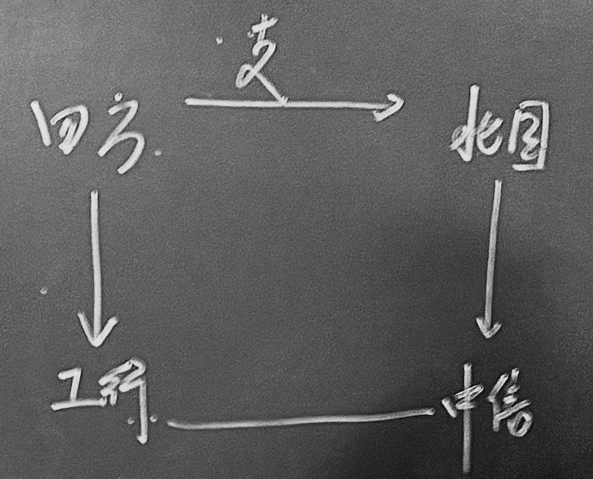
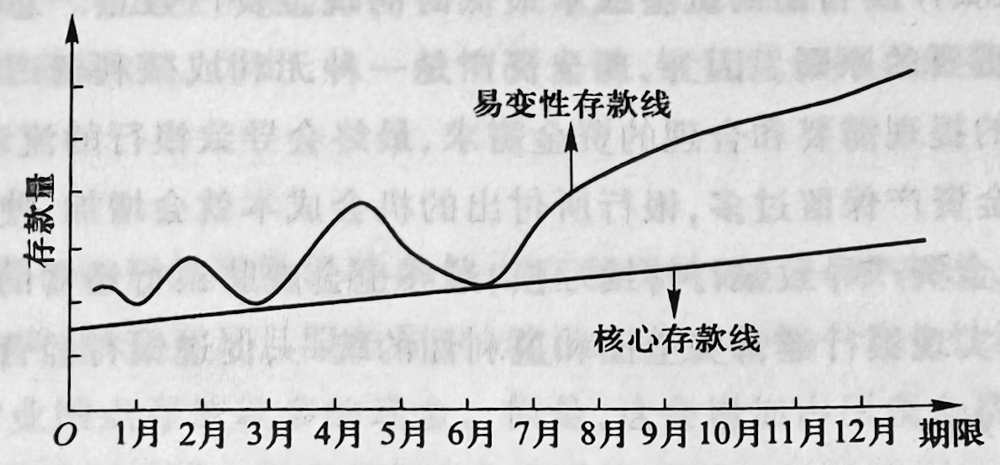
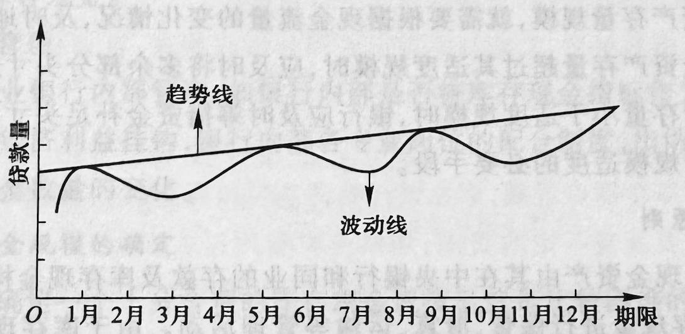

# 现金资产业务

---

### 第一节 现金资产构成和作用

#### 一、构成

指银行持有的**库存现金**以及**与现金等同的可随时用于支付的银行资产**

##### （一）库存现金

保存在金库中的现钞和硬币

- 用来应付客户体现和银行本身的日常零星开支

- 属于**非营利资产**，且保护和保险费用较高

- 持有满足需要的最低额度

##### （二）在中央银行存款

按货币管理当局规定，在中央银行开设的准备金基本帐户上所形成的存款

- 法定准备金 – *按法定比率缴存的存款准备金*
  
  - 具有强制性，一般不得动用
  
  - 定期按照银行存款额的增减进行相应调整
  
  - 是中央银行进行宏观调控的一般性货币政策工具之一

- 超额准备金 – *超出法定存款准备金的那部分存款*
  
  - 是商业银行的**可用资金**，可随时动用
  
  - 可以进行日常支付和贷放活动，如支票清算、电子划拨和其他交易
  
  - 当银行库存现金不足时，也可随时从该部分提取现金

##### （三）存放同业存款

存放在代理行和相关银行的存款

- 属于活期存款，是营运资本的一部分

- 便于银行在同业之间开展业务

##### （四）在途资金

本行通过对方银行向外地付款单位或个人收取的票据

即银行间确认与转账过程中的支票

- 形成原因：*个人、企业或政府部门将其收到的支票存入银行时，不能立即调用该款项，而必须在银行经过一定时间确认后方可体现收用*
  
  > *支票确认流程相当繁琐，详见国际结算、国际贸易等相关课程有讲解，这里不赘述*
  
  

- 时间规定
  
  - 发达国家：约 1～4 天
  
  - 我国：约 7 个工作日
  
  > *持续时间往往很短，因此本章计算头寸时也为将此例外考虑在内*

#### 二、作用

> *库存现金往往不会对银行带来收益，即使有也十分有限*
> 
> - 满足客户交易要求
> 
> - 满足金融当局法定存款准备金要求
> 
> - 满足结算中对现金的需求
> 
> - 满足向其代理行支付现金以换取服务的要求
> 
> 等最低限度要求即可

##### （一）保持清偿力

##### （二）保持流动性

---

### 第二节 资金头寸的计算与预测

#### 一、资金头寸及其构成

*商业银行能够动用的资金*

- 时点头寸 – *时点可用资金*

- 时期头寸 – *时期内可用资金*

##### （一）基础头寸 `库存+超额准备`

*商业银行的**库存现金**与在中央银行的**超额准备金**之和*

##### （二）可用头寸 `!法定准备=基础+同业=支付准备+可贷`

*除法定存款准备金以外的所有现金资产*，包含两方面

> *可以直接理解为商业银行**基础头寸**和**存放同业存款**之和，不考虑在途资金*

- 支付准备金（备付金） – *央行以备付金率规定商业银行必须持有的备付金*
  
  > *我国已取消该比率，将其并入法定存款准备金率*

- 可贷头寸 – *商业银行某一时期可直接用于贷款发放和投资的资金*

#### 二、资金头寸的预测

##### （一）影响因素

*存款变动、贷款变动、购买变现债券、收购发行股票等*

###### 增加因素

*流动性供给*

- 客户存款

- 提供非存款服务所得收入

- 客户偿还贷款

- 银行资产出售

- 货币市场借款

- 发行新股

- 变现债券

###### 减少因素

*流动性需求*

- 客户提取存款

- 合格贷款客户的贷款要求

- 偿还非存款借款

- 提供和销售服务中产生的营业费用和税收

- 向股东派发现金股利

- 收购股份

***主要影响因素依然是存贷的变化***

##### （二）存款变化趋势图

按存款变化规律可以分为三类

- 一定会提取的存款 – *定期存款、金融债券，因有约而无需预测*

- 可能会提取的存款 – *定活两便、零存整取、到期自动转存等，有可能提取但不能确定*

- 随时可能提取的存款 – *活期存款*

存款预测对象主要是后两者，被称为*易变性存款*

把存款需求波动线的*最低点*连接起来，形成*核心存款线*

核心存款线以上的曲线为*易变性存款线*

***二者围成的面积就是存款的现金需求***

##### （三）贷款变化趋势图

把贷款需求波动线的*最高点*连接起来，形成*贷款趋势线*

***贷款趋势线与贷款波动线围成的面积就是贷款的现金需求，又称可贷资金头寸***

---

### 第三节 现金资产的管理

#### 一、现金资产管理原则

- 总量适度原则

- 适时调节原则

- 安全保障原则

#### 二、库存现金的日常管理

##### （一）影响银行库存现金的因素

- 现金收支规律

> *由于商场营业时间往往持续到很晚，大型商场都有自己的金库，银行每天早上再取走日营业款存入账户，因此对于银行而言每天早上都会有一笔大量现金收入，如今这一特点因为电子支付的普及已经不再明显*

- 营业网点的多少

- 后勤保障的条件

- 与中央银行发行库的距离、交通条件以及发行库的规定

- 商业银行内部管理

##### （二）银行库存现金规模的确定

###### 1. 库存现金需要量的匡算

库存现金是为了完成每天现金收支活动而需要持有的**基期周转金**，匡算库存现金需要量主要应考虑两个因素

$$
库存现金需要量=库存现金周转时间\times即期现金支出水平
$$

**(1) 库存现金周转时间**

- 营业网点分布

- 交通运输条件

- 进出库制度

> *无法量化计算*

**(2) 库存现金支出水平的确定**

$$
即期现金支出水平=(前期平均现金支出水平\times保险系数)\times历史同期平均发展速度
$$

- $前期平均现金支出水平=\frac{前30天现金支出累计发生额}{30}$

- $保险系数=标准差\times置信概率度$ – *来自计量经济学*

- $标准差=\sqrt{\frac{\sum(每天现金支出额-平均现金支出额)^2}{30}}$

> 事实上，库存现金需要量类似于企业边际收益等概念，***更多还是根据经验选择保留***，毕竟数据难以量化的同时，其本身的选取也取决于经验

###### 2. 最适送钞量的计算

> *寻找使银行为占用库存现金和运送钞票所花费的费用之和最小化的运钞量*

常用经济批量法来进行测算，公式有

$$
T=C\cdot\frac{Q}{2}+P\cdot\frac{A}{Q}
$$

- $C$：现金占有费率，即银行看管库存现金产生的费用率（百分数）

- $Q$：每次运钞数量
  
  - $\frac{Q}{2}$：根据会计库存原理，从开始到消耗为零这段时期的实际库存（与两轴面积，也可称平均库存）是初期库存的一半
  
  > *想象一个截距为 $Q$ 递减的一次函数与两轴相交形成的图形，平均库存是三角形面积，恰为矩形面积的一半*

- $P$：每次运钞费用

- $A$：一定时期内的现金收入/支出量
  
  - $\frac{A}{Q}$：总量比单量，即运钞次数

- $C\cdot\frac{Q}{2}$：这段时期现金在库产生的费用

- $P\cdot\frac{A}{Q}$：这段时期运钞产生的费用

因此可以直接对该式微分求得一阶导数，令 $T'=0$ 即可得到 $Q$ 的最小值，得

$$
Q=\sqrt{2A\cdot P/C}
$$

###### 3. 现金调拨临界点的确定

低于某值，则必须进行现金调拨

同时考虑银行从提出现金调拨申请到实际收到现金需要有一个或长或短的过程

$$
现金调拨临界点=每天最大支出量\times提前时间
$$

> 其实严格完全展开的公式是
> 
> $$
> 现金调拨临界点=每天正常支出量\times提前时间+保险库存量
> $$
> 
> $$
> 保险库存量=(每天最大支出量-每天正常支出量)\times提前时间
> $$
> 
> 可以看出最上面的式子其实就是这两个式子运用*乘法分配律*简化得到的
> 
> ~~保险库存量在这个公式就是个神秘的无意义操作~~

###### 4. 银行保持现金适度量的措施

- 将库存现金状况与有关人员的经济利益挂钩

- 实现现金出纳业务的规范化操作

- 掌握储蓄现金收支规律

- 解决压低库存现金的技术性问题

#### 三、存款准备金的管理

##### （一）满足法定存款准备金要求

###### 1. 滞后准备金计算法

*(〇 _。)?*

###### 2. 同步准备金计算法

*理解できないわ〜*

##### （二）超额准备金的适度规模控制

###### 1. 影响超额准备金需要量的因素

- 存款波动

- 贷款的发放与收回

- 其他因素

###### 2.超额准备金的调节

- 同业拆借

- 短期证券回购及商业票据交易

- 通过中央银行融资

- 商业银行系统内的资金调度

- 出售其他资产

#### 四、同业存款的管理

##### （一）同业存款的目的

*支付代理行待办业务的手续费*

##### （二）同业存款需要量的测算

###### 1. 使用代理行的服务数量和项目

###### 2. 代理行的收费标准

###### 3. 可投资余额的收益率

*代理行通过对同业存款的投资获取收益来弥补其为他行代理业务所支付的成本，因此可投资余额的收益率也会影响同业存款需要量*

- 收益率高 -> 需要量变低

- 收益率低 -> 需要量变高