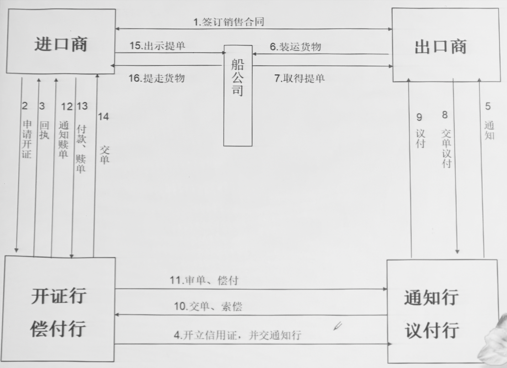

# 信用证结算方式

---

### 第一节 信用证的概念及特点

#### 一、概念

一项不可撤销的安排，无论其名称或描述如何，该项安排构成开证行相符交单予以承付的确定承诺

#### 二、特点

- 是一种银行信用

- 是一种自足文件

- 是一种单据业务

---

### 第二节 内容及开证方式

#### 一、内容

- 本身的说明

- 当事人

- 金额和汇票

- 货物条款

- 运输条款

- 单据条款

- 其他规定

- 等

#### 二、方式

- 信开

- 全电开本 – *速度快、安全可靠、费用高*

  - 其中 *SWIFT* 形式最为常见

- 简电开立，附寄证实书 – *银行可能不接受证实书，存在风险*

---

### 第三节 信用证的形式及内容

---

### 第四节 信用证的一般业务程序

> *属于单据业务*
>
> *信用证是独立于合同外的独立性文件，也称自足性文件*

---

### 第五节 信用证的种类

#### 一、根据性质

- 备用信用证

- 跟单信用证

#### 二、根据是否附带货运单据

- 光票信用证

- 跟单信用证

#### 三、根据开证行对其所负责任

- 可撤销信用证

- 不可撤销信用证

#### 四、根据是否有另一家银行加保兑

- 保兑信用证

- 不保兑信用证 – *使用较广泛*

#### 五、根据信用证支付方式

- 即期付款信用证

- 延期付款信用证

- 承兑信用证

- 议付信用证

#### 六、红条款信用证

又称*预付款信用证*或*预支信用证*

#### 七、对开信用证

适用于易货贸易、补偿贸易

#### 八、循环信用证

适用于长期均匀交货的交易

#### 九、背对背信用证

#### 十、可转让信用证

适用于有中间商存在且中间商要赚取差价的情况，特别注明 “可转让（*transferable*）”字样
